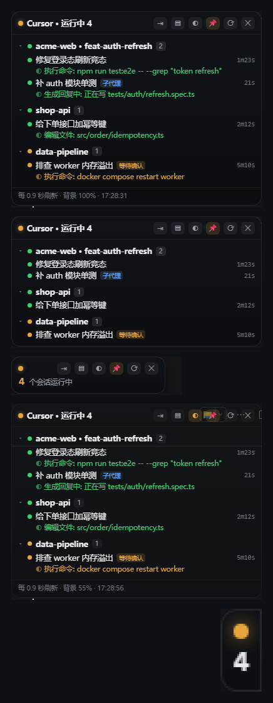

# cursor-float

一个常驻置顶的浮窗，实时显示 **Cursor 里正在运行的 Agent 会话**——哪些项目在跑、每个会话叫什么、**此刻在执行什么**（跑哪条命令、改哪个文件）。类似 Codex 的浮窗。

界面是 PySide6 + QtWebEngine 渲染的半透明卡片：**背景可以调透明度，文字始终清晰**；可以**贴边自动收起**，鼠标移上去再展开；最简可以只显示一句「几个会话在运行」。



<sub>由上到下：详细模式、简约模式、最简模式、详细模式下背景 55% 透明（能透出后面的桌面，而文字依然清晰）、以及贴边收起后的细条（放大 3 倍，琥珀色表示有会话在等待确认）。</sub>

## 运行

双击 `启动悬浮窗.bat`。脚本会找一个带 PySide6 的 Python，缺失时自动 `pip install`（首次需要联网，PySide6 约几百 MB）。

想放到桌面：右键 `启动悬浮窗.bat` → **发送到** → **桌面快捷方式**，再把快捷方式的图标改成同目录的 `cursor-float.ico`。

手动启动：

```powershell
pip install -r requirements.txt
python app.py
python app.py --demo        # 用编造的会话数据看外观，不读数据库
```

界面由 PySide6 自带的 QtWebEngine 渲染，不依赖系统 WebView2。需要 Python 3.10+。

## 界面

标题栏按钮从左到右：

| 按钮 | 作用 |
| --- | --- |
| `⇥` | **贴边自动收起**开关（默认开）。窗口拖到屏幕边缘才收起，鼠标移上去展开 |
| `▤` | 在「详细显示 / 简约显示 / 最简显示」之间循环 |
| `◐` | 背景透明度在 100 / 85 / 70 / 55 / 40 / 25% 之间循环 |
| `📌` | 窗口置顶开关 |
| `⟳` | 立即刷新 |
| `✕` | 关闭 |

整个标题栏都是拖动区域。点击项目行可以折叠/展开该项目，折叠后仍显示会话数、该项目最紧急的状态色和当前动作类型；折叠状态会记住。

三种形态：

- **详细显示** — 项目分组的项目名 + 会话名 + 当前动作行 + 页脚。
- **简约显示** — 去掉动作行和页脚，只留项目名和会话名。
- **最简显示** — 窗口收窄成一条，只显示「几个会话在运行」。

### 贴边自动收起

这是**位置驱动**的，不是一个会把窗口拽走的模式：

- 窗口**放在屏幕中间时，行为和普通浮窗完全一样**——不吸附、不收起、位置分毫不动。
- 把窗口**拖到左边缘或右边缘附近**（24px 以内）松开，它会贴齐那条边；之后鼠标离开 0.7 秒，收起成一条 22×76 的细杆：

```
                        ╭──╮
                        │ ●│   ← 圆点：绿=在跑，琥珀=有会话等待确认
                        │ 4│   ← 运行中的会话数
                        ╰──╯   ← 贴着屏幕右边缘
```

- 鼠标靠近细杆（含 10px 容差）立刻展开回原来的形态；点一下细杆也能展开。
- **把窗口从边上拖回中间，它就恢复成普通浮窗**，不再收起。

细杆收起后会「重新武装」——鼠标必须先离开再靠近才会展开，不会在边缘来回抖。标题栏最左边的 `⇥` 是这个特性的总开关（默认开）；关掉之后连贴边吸附也不会发生。

收起状态下记录的是**展开时的位置**，所以下次启动不会以细杆的位置为准。

### 透明度是怎么做的

窗口是 Qt 的逐像素半透明窗口（`WA_TranslucentBackground`），页面每个像素的 alpha 直接和桌面混合。透明度只作用于**背景层**（CSS 变量 `--bg-alpha`，所有背景都写成 `rgba(r,g,b,calc(基础值 * var(--bg-alpha)))`），文字、圆点、图标一律不透明，所以调低透明度时能透过卡片看到后面，数字和标题依然清晰。圆角外的区域是真正透明的。

## 它是怎么知道 Cursor 在干什么的

**完全不碰 Cursor 的任何文件写入，也不装扩展、不调 API**，只以只读方式打开 Cursor 自己的本地状态库：

```
%APPDATA%\Cursor\User\globalStorage\state.vscdb      (SQLite，本机约 8 GB)
```

用到里面三处数据：

| 数据 | 用途 |
|---|---|
| `composerHeaders` 表 | 会话清单：标题、所属工作区、最后活动时间、是否归档、是否子代理 |
| `cursorDiskKV['composerData:<id>']` | 会话内容，用于「有没有在变」的判定与当前动作 |
| `cursorDiskKV['bubbleId:<id>:<bid>']` | 最近一次工具调用：工具名 + 命令/文件路径 + 执行状态 |

### 「正在运行」怎么判定（这节很重要）

Cursor 主程序里确实有一套状态机——新会话 `status = "none"`，请求开始时置 `"generating"`，结束为 `"completed"`，中断为 `"aborted"`。**但那是内存里的对象，落盘到 `state.vscdb` 的时机完全不同步。**

在真实库上连续采样一个正在生成中的会话，得到的是：

| 字段 | 生成期间的实际表现 |
|---|---|
| `composerData.status` | 恒为 `"aborted"` —— 上一次落盘的残留值，**不是实时状态** |
| `composerData.generatingBubbleIds` | 恒为 `[]` —— **不是实时状态** |
| `composerHeaders.lastUpdatedAt` | 冻在回合开始那一刻，全程不动 |
| `composerHeaders.checkpointAt` | 也不是心跳，会停在某一刻 |
| **`composerData` 的内容** | **在变**：气泡数 42→43→44→45，blob 长度 +447 / +8456 / -8079 |
| **最后一条气泡的 `toolFormerData`** | **在换**：`run_terminal_command_v2` → None → `glob_file_search` |
| **该工具的 `status`** | **`"loading"`** |

所以判定依据是：

1. **内容在变化**（主信号）：记录每个会话 `composerData` 的指纹（气泡数 + 最后一条气泡 id），两次轮询之间变了就说明它在干活；最后一次变化后 45 秒内仍视为运行中，用来跨过工具调用之间的空档。
2. **最后一条工具的状态是 `loading`**（辅助信号）：实测 40 个已结束的会话里，最后一条气泡要么没有工具、要么是 `completed`，只有真正在跑的那个是 `loading`。
3. 另外还会认 `generatingBubbleIds`、`isApplyingWorktree` 等字段，以及 `hasBlockingPendingActions`（显示成琥珀色的「等待确认」）。

> **别改回去用 `status` 判断。** 那是最初版本的写法，表现就是「明明在跑却什么都不显示」。

「当前执行什么」按优先级取：正在跑的工具 → 内容正在变化（正在生成回复）→ Cursor 自己的 `subtitle` 摘要。工具名会翻译成中文，例如 `run_terminal_command_v2` → `执行命令`。

### 不显示？先跑这个

```powershell
python sessions.py --watch --signals
```

它会逐个列出**本次检查过哪些会话、各自的判断依据、以及为什么没显示**：

```
· 1a2b3c4d [不显示] my-project / 重构支付回调
    status=completed 气泡=54 gen=0 内容变化=False 45秒内变化过=False 工具在跑=False 头部新鲜=False (头部329.2秒前)
    => 没有任何活跃证据（内容没变、工具没在跑）
```

看到 `内容变化=False` 且 `工具在跑=False`，就说明那个会话确实没有在动。

**`--once` 默认会观察最多 4 秒**，因为判定依赖「内容较上一轮有变化」，只查一轮会把正在跑的会话漏掉（这一点踩过坑：同一个库，浮窗显示有会话在跑，`--once` 却报空）。`--settle 0` 只看一轮。

## 性能

状态库接近 8 GB，单个会话对象最大见过 3.9 MB（json 解析约 25 ms，是这里最大的开销）。做法：

1. **带摘要校验的解析缓存**：先取原始字节算出「长度 + 内容摘要」，和上次一致就直接复用解析结果，跳过 `json.loads`。不要退化成只比长度——内容更新后长度有可能恰好不变。
2. **只检查值得看的会话**：头部时间戳在 15 分钟窗口内的、最近被判定活跃过的、最靠前的若干条；启动首轮再多看几个（不超过 `first_scan`）。
3. **只在变化时推送给页面**：每次推送都会触发页面重排和高度自测，无脑推送会让窗口不停地重新测量。

本机实测：稳态每次轮询中位数 **17 ms**，启动首轮 **78 ms**，默认 900 ms 一轮。

## 配置

在脚本同目录建 `config.json`，覆盖任意一项即可：

```json
{
  "interval_ms": 900,
  "grace_seconds": 25,
  "activity_grace_sec": 45,
  "candidate_window_sec": 900,
  "track_keep_sec": 600,
  "header_scan": 60,
  "live_scan": 8,
  "first_scan": 12
}
```

| 项 | 含义 |
|---|---|
| `interval_ms` | 轮询间隔 |
| `grace_seconds` | 头部时间戳在此秒数内仍视为运行中，用于回合刚开始的时刻 |
| `activity_grace_sec` | 观察到内容变化后，还视为「运行中」多久（跨过工具调用之间的空档） |
| `candidate_window_sec` | 头部时间戳在此窗口内的会话会去检查 |
| `track_keep_sec` | 曾经活跃过的会话，继续检查多久 |
| `live_scan` | 无论时间戳如何都强制检查的最靠前会话数（兜底） |
| `first_scan` | 启动首轮最多检查多少个（避免首屏把历史大对象全解析一遍） |

窗口状态（位置、显示形态、透明度、置顶、**是否贴边收起**、折叠了哪些项目）保存在：

```
%USERPROFILE%\.cursor-float\window.json
```

下次启动自动恢复；保存的位置若落在已经拔掉的显示器上，启动时会被拉回主屏幕可视区域。启动失败的原因会写到同目录的 `last-error.log`（`pythonw` 没有控制台可打印）。

## 测试

```powershell
python -m unittest test_sessions test_app -v
```

两组共 53 个用例，都不依赖本机真实数据，也**不需要安装 Qt**：

- `test_sessions.py`（23 个）：判定逻辑。生成中 / 工具执行中 / 等待确认 / 已归档 / 结束即消失；**真实落盘行为**（`status="aborted"`、`generatingBubbleIds` 为空、头部时间戳冻住，只靠内容变化识别）；`loading` 算在跑而 `completed` 不算；内容停止变化后超过宽限期即消失；解析缓存不重复 `json.loads`；两个项目并发都要显示；长时间运行的大会话不能丢。
- `test_app.py`（30 个）：窗口状态与展示逻辑。模式/透明度的归一化、状态文件读写与损坏兜底、窗口位置夹取（含实测过的「拖到屏幕外」场景）、**贴边收起的几何计算**（吸附到更近的边、纵向居中不出屏、展开时回到原来那条边）、项目分组排序、推送指纹。

界面交互另有一个自检入口，会点一遍卡片上的按钮并回读页面状态：

```powershell
python app.py --selftest
```

## 开发辅助

`tools/capture.py` 依次截取三种形态、55% 透明度、贴边收起共 5 张，合成根目录的 `_preview.png`：

```powershell
python tools\capture.py
```

它用 `--demo` 的编造数据，所以截图里不会有真实项目名。单张截图放在 `_shots/`（不提交）。需要 Pillow。

`python app.py --shot out.png` 会在启动 6 秒后自动截图并退出；加 `--fold` 可以以收起状态启动。

## 文件说明

| 文件 | 说明 |
| --- | --- |
| `app.py` | Qt 无边框半透明窗口、与页面通信的 QWebChannel 桥、状态持久化、尺寸/位置控制 |
| `card.html` | 卡片界面（HTML/CSS/JS），三种形态、背景透明度、高度自测 |
| `sessions.py` | 数据层：只读读 `state.vscdb`，判定哪些会话在运行；也可当命令行诊断工具 |
| `window_state.py` | 窗口状态与展示逻辑（纯计算，不导入 Qt，便于测试） |
| `test_sessions.py` / `test_app.py` | 单元测试 |
| `tools/capture.py` | 生成 `_preview.png` 的开发脚本 |
| `启动悬浮窗.bat` | 双击启动（自动检查/安装依赖） |
| `cursor-float.ico` | 桌面快捷方式用的图标（会话列表造型） |
| `requirements.txt` | PySide6；Pillow 仅截图时需要 |

## 已知限制

- **本机 QtWebEngine 的 GPU 合成会失败**（日志里是 `Compositor returned null texture` / `Failed to create shared context`），表现是窗口完全透明、屏幕上什么都看不到，很容易被误判成程序没启动。`app.py` 里已经默认关掉 GPU 合成（`QTWEBENGINE_CHROMIUM_FLAGS=--disable-gpu --disable-gpu-compositing`），想在别的机器上调回去，启动前设这个环境变量即可。
- 只覆盖**本机 Cursor**。云端/后台 Agent 走的是另一套 `BackgroundComposerStatus`，本工具不处理。
- 依赖 Cursor 的内部存储结构。Cursor 升级若改了 `state.vscdb` 的字段，需要跟着调整；核对方法见上面「它是怎么知道」一节。
- 浮窗是独立进程，不随 Cursor 启停；关掉 Cursor 后它会显示「空闲」。
